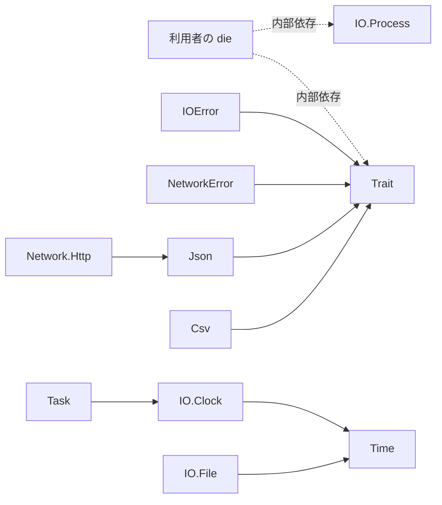

# P2 型の変更範囲と依存の確認

## 基準と読み方

開始時の HEAD は `daa50081364b9cbd3962ed473390d7cdf61d18af`、作業ツリーは clean である。P1 の入力・移行一覧を前提に、design.md「変更する型と受け渡し」の各行を現在の実装へ対応付けた。以下の変更は後続作業への案であり、P2 では型・関数・言語の振る舞いを変更していない。R2 は設計者が回答済み、R19・R20 は今回補った推す案である。

`src/`・`tests/`・`stdlib/` はそれぞれ `crates/benitoite/src/`・`crates/benitoite/tests/`・`crates/benitoite/src/prelude/stdlib/` を指す。[uses.json](uses.json) は構築・参照・全走査の検索位置をファイルと行番号で保存し、Rust/Lean/Python/shell の 259 ファイルと標準ソース 52 ファイルの SHA-256 を持つ。[inventory.py](inventory.py) の各正規表現を明示して再抽出できる。字面の候補には同名の別の型やコメントも含むため、意味上の参照解決の結果ではない。後続はこの表で担当と意味を確認し、実装開始時に再検索する。通常のテストからこのディレクトリへ依存を加えない。

## 型・受け渡しの対応表

| design の対象／担当 | 構築・入口と実際の使用箇所 | 変更時に保つ契約／uses.json の組 |
|---|---|---|
| TokenKind／A1 | `syntax/token.rs`。`lexer.rs` の keyword、`parser/text.rs` の表示・綴り、`newline.rs` の is_keyword/continues_after、`lambda_bounds.rs`、parser の名前・式・型・ラベルの入口 | KwTry 14 候補を plan の表と照合する。KwDie は文の継続語にしない。formatter に独立した語表を増やさない。`token` |
| TryExpr／B6・B7・B10a-1・B11 | 構築は `syntax/parser/effects.rs:451` の一か所。`resolve/walk.rs`、`typeck/{generate,consts}.rs`、`typeck/effects/{mod,tail}.rs`、`ir/desugar/exprs.rs`、formatter の roles/walk・print・verify、`tests/desugar_export/exchange.rs`・`runtime/assert.rs`・`tests/random_programs/shrink.rs` | B6 は ImplicitReturn/Return、Die は B10a-1 の内部検査から。入力と説明を両方辿る。const は全 try を拒否。lambda 内の別の return 境界を保つ。`try_ast` |
| AdtDef／D5・D6c | 本番の構築は `typeck/decls.rs:723`。直接構築は `types/mod.rs`、`typeck/patterns.rs`、`ir/{check,decision}.rs` の単体入力、`tests/coverage_export.rs:157`。型表の参照は同ファイル群・records・IR・交換出力 | `extensible` は data/record 共通、既存入力は false。R2 の ParseError は record のまま。ctor の tag・fields・生成 API は維持。`adt` |
| same_package／D5 | 定義 `resolve/collect.rs:78`、現在の呼び出し `resolve/lookup.rs:236`。`ResolveOutput` は `resolve/mod.rs`、`typeck/decls.rs` が modules/resolved を保持 | 共通の判定を ModuleTable を受ける補助へ移し、名前解決と view の生成で共用できる。Entry/User、Prelude/Stdlib、Package の先頭の依存別名の比較をそのまま保つ。Config/PackageConfig、取得失敗は false。新しいパス推測は不要。`package` |
| ModuleInfo・ImportLink／B10a-1・B11 | 構築 `modules/load.rs:159,483`（通常・設定）、`:350`（明示辺）。消費は `modules/cycle.rs`、`resolve/imports.rs`・`collect.rs`、`typeck/decls.rs`、formatter/imports、テストの入力 | 内部辺は別欄で target と Span を持つ。ImportLink の NodeId を捏造しない。明示 import からの利用者名は現行処理のまま。循環の起点は R19。`module_edges` |
| check_match・check_binding／D6a | 公開入口 `typeck/patterns.rs:135,188`。本番呼び出し `typeck/pattern_ext.rs:324,403`。`tests/coverage_export.rs:312,343,588`、patterns の既存表と check_match_with の予算入力 | 明示 view を引数に追加し全呼び出しを同時更新。useful・shapes・overlap・covering・反例・メモへ渡す。Search 一回の間で不変、異なる view 間でメモを共有しない。E0609 と部分結果を返さない条件を保つ。`coverage` |
| Shape／D6a | 非公開 enum `typeck/patterns.rs:202`、shapes・specialize・witness と探索の全場合。同名の外部コンポーネント用 Shape は別物 | Future(BindingId) は欄 0。Other は残す。Wild だけが Future を覆う。`coverage` |
| Body・Body::new／D5 | 定義 `typeck/context.rs:50,100`。構築は `generate.rs:108`（関数・実装メソッド）、`consts.rs:63`、`traits/solve.rs:324`（補助の制約検査）の三か所 | 最後の一か所も更新が必要。関数・const は束縛の module、補助 check_bounds は呼び出し元の Body.module または実装の ImplDef.module を明示して渡す。後者の呼び出しは `traits/solve.rs:411` と `traits/impls.rs:157`。内部補助の引数追加はこの Body の接続に含む。lambda/guard/lazy は同じ Body を使い、module を切り替えない。`body` |
| MatchIssue・BindingCheck／D6a | `patterns.rs:46,82` と witness の生成・Search のメモ。消費は `pattern_ext.rs`、patterns のテスト、coverage_export の出力 | 非網羅の文字列とともに将来の形の BindingId を保持する。Search 内の結果とメモも型の出どころを落とさない。複数型の入れ子を文字列で逆解析しない。`coverage` |
| TryInfo・TypeckOutput／B10a-1 | `typeck/mod.rs:62,102`、構築 `context.rs:414`、途中の表 `Body.try_kinds`、`typeck/effects/special.rs`、消費 `ir/desugar/{exprs,effects}.rs` と exchange | Return の ret と Die の辞書/exit を分ける。Option の show=None、Result は確定辞書。TypeckOutput の既存の expr_types/type_args を再利用。`try_types` |
| Constraint::Try・Body／B10a-1 | 定義 `typeck/infer.rs:225`、生成・解決 `typeck/effects/{mod,special}.rs`、`solve.rs:1094` 以降、`traits/solve.rs`、最終化 `context.rs` | Try の特殊制約が E を確定→Show の Class 制約を登録→辞書解決→確定表。既存の遅延解決の再試行と終端判定を更新する。Die に囲む ret を要求しない。`try_types` |
| Core/LCompKind::App／B9・B10a-2 | `ir/{core_ir,lower_ir}.rs`、構築/変換は `desugar`・`desugar/dicts`・`decision`、使用は `check` と各 IR の自由変数/置換の走査、bytecode/codegen、refinterp の convert/eval、交換出力・正規化 | 任意の ExitReportArgs を全再構築へ運ぶ。cause/message は使用する値。IR check は標準 exit・code=1・String・効果を検査。公開の操作の引数は増やさない。`app` |
| Proto／B9 | 構築 `bytecode/{asm.rs:249,codegen/mod.rs:263,codegen/state.rs:79,verify.rs:571}`。レジスタ/使用位置は codegen・liveness、消費は verify/disasm・vm/dispatch・CompiledProgram の IO 被演算子 API | ExitReportSite の表を命令位置へ対応させる。通常 IO 引数は一つ。VM 自身も命令・範囲・値の種類を確認する。verify の本番経路への追加は不要。`proto` |
| VM の要求・停止結果／B10-1・B10-2 | `vm/{mod,state}.rs` の StopEnd/RunState、`vm/dispatch/{tasks/io,unwinding}.rs`、`runtime/io/mod.rs` の Request/LiveRequest/DispatchQueue と services、run の step_end | 要求単位の所有文字列を採用した停止へ渡す。Request は現状 Copy なので、そのまま String を加えるなら Copy を外す必要がある。公開 publish の引数を増やす代わりに、既存の site と Proto の表を使って採用前に文字列化する構成を検討する。StopReason::Exit の優先順位は保つ。`exit_flow` |
| RunEnd／B8・B10-2 | 定義 `runtime/run.rs:93`、構築/上書き `:360,373,425,440,449,460,873,904`（関数の戻り型だけの候補は除く）。CLI、test_runner、golden/differential、ランタイムの既存テストが読む | plain/internal・中断・panic の経路は None、採用された Exited(1) だけ Some。main_error とは独立。補足 reports によって終了状態を変えない。`exit_flow` |
| RefOutcome::Exited／B10-1、R20 | 定義 `refinterp/mod.rs:31`、生成 resources/eval、比較 `tests/golden/differential.rs`・`tests/random_programs.rs` と refinterp の単体入力 | 所有した DieFailure を追加し、通常 exit と die を比較で区別。位置と文章の正規化で情報を消さない。公開 run の引数と戻り型名は維持。`exit_flow` |
| ReportKind／B8 | `diag/mod.rs`、全場合の列挙 `diag/render.rs:534,983`、`cli/tools/skill/generate.rs:257`、render の既存表、CLI の実行終了の描画 | Die は code=null・kind=die。既存 Diagnostic の notes/primary を使う。CLI は最終転送の後に一回、reports より先。`report` |
| test runner Failure::Exit／B8・B11・B12 | `cli/tools/test_runner/mod.rs:49,654`、`report.rs:112,265`（文章/JSON）、`report/tests.rs:114` | 通常 exit code=0 も失敗という既存条件を維持し、die も次のテストへ進む。捕捉出力へ二重描画しない。`exit_flow`, `report` |
| BreakingChange／M6 | `modules/package.rs:156,162,270,352〜364`（非公開型、表・判定・既存の表テスト）、`modules/text.rs`、E0908 と package_command/golden | help を追加し全該当版を列挙。R17 の Diagnostic.notes/helps で実現し DiagBuilder の公開引数を増やさない。`breaking` |
| Lean・Exchange／D1〜D4・B1〜B5 | [formal.md](formal.md) の定義・定理・六入口の表、Rust の coverage_export・desugar_export 一式、formal/tests の独立入力 | corpus 8→9→10、型表/網羅性 2→3。対象外へ移して件数を減らさない。`formal_coverage`, `formal_surface`, `exchange` |

型表の変更はこの表と design の範囲でレビューする。新しい公開関数のシグネチャ変更を P2 で実施したものはない。VM/IO の欄の具体的配置は B10 の設計範囲内で決めるが、IoServices の公開操作に報告引数を足すこと、ヒープ API を増やすこと、Process.Exit の操作を追加することは含まない。RefOutcome の明記漏れだけを R20 で補った。

## 標準ライブラリと内部依存の接続

52 の標準ソースを調べた。現在の明示 import は `Task → IO.Clock → Time`、`IO.File → Time`、`Network.Http → Json` の四辺であり、Trait・IO.Process・四つの Show 対象モジュールには明示 import がない。全辺と位置は uses.json の stdlib_imports にある。以下で `→` は明示 import、`⇒` は今回追加する die の内部辺を示す。

| モジュールの列 | 接続と循環の確認 |
|---|---|
| 利用者の die ⇒ Trait、利用者の die ⇒ IO.Process | 同じ標準モジュールを scheduled/loaded の名前表で一度だけ読む。Trait/Process を局所名で探さず、標準束縛番号は ResolveOutput.stdlib_names と builtin_ops から引く。内部辺は try の Span を持つ |
| IOError → Trait、NetworkError → Trait | B10-3 で `import Benitoite.Trait`。型自身のモジュールで `implement Trait.Show[IOError]` / `[NetworkError]`。`show(x: ...)` から `message(x)` を呼ぶ |
| Json → Trait、Csv → Trait | 同じ import と `implement Trait.Show[ParseError]`。record の生成 getter `ParseError.message(x)` を呼ぶ。現状には IOError.message と同じ形のトップレベル message はない |
| Task → IO.Clock → Time、IO.File → Time | 既存の辺。Time から Trait/四型への逆の明示 import はない |
| Network.Http → Json → Trait | Json への既存の明示 import に追加の Trait を接続。Trait から Network.Http/Json へ逆の明示 import はない |

prelude の読み込みと名前の公開は、上の辺と区別する。`prelude/mod.rs` は IOError・NetworkError を prelude=true、Trait・IO.Process・Json・Csv を false としている。`modules/load.rs:103` が入口の次に prelude を予定し、`resolve/collect.rs:242` 以降がそのモジュール名と組み込み型を全体の名前表へ登録する。Trait は Integer・List・Option などの既存 prelude 名を使うが、そこから全 prelude への import 辺を作ってはいない。IO.Process の IOError 型の使用も同じである。全 prelude への逆辺を追加すると、`IOError → Trait → IOError` の人工的な循環を作るので行わない。

四実装の孤児規則は `typeck/traits/impls.rs:52` の実装モジュールと型/クラスの定義モジュールの比較に従う。組み込み二型の定義モジュールは `types/builtin.rs` の IOError/NetworkError、record 二型は各宣言の Binding.module であり、いずれも型自身のモジュールに一致する。Trait の既存実装にも四型の重複はない。Show の引数名は宣言の `x` と揃える。Kind 二型を自動的に表示可能にはしない。

循環検出の現状は入口一つを起点にする。新しい内部辺の探索と同時に、入口で到達しなかった読み込み済みモジュールも ID 順に探索し、done を共有する案を R19 に残した。閉じる辺が内部辺なら try の Span、明示辺なら import の Span で E0322 を作る。これにより prelude 内の die も通常の循環検査から漏れない。現在の六つの関連モジュールへ追加する辺自体には循環がないという静的な確認であり、新しい loader を実行して検証した結果ではない。

内部辺によって Trait/Process という名前は利用者スコープへ加えない。`uses Process.Exit` は通常の import が必要であり、E0501 の案内は import の有無と既存の別名も確認する。R2 の属性対象四型（Kind 二型と ParseError 二型）と、今回の標準 Show 四型（不透明二型と ParseError 二型）は別の集合である。
