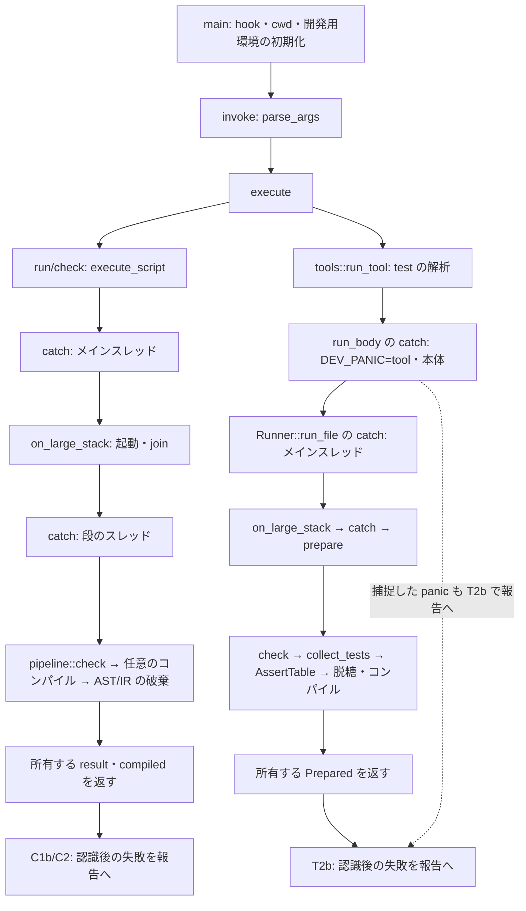

# P2 型・呼び出し元・所有関係の確認表

## 基準と検索範囲

2026-10-17、ブランチ `mod254/P2`、HEAD `c232d0bdc6098e7eb4a7b0261576628fd641b9fe` で確認した。開始時の `git status --short` は空であった。行番号はこの HEAD のものを示す。以下の `src/`・`tests/` は `crates/benitoite/` の下である。

`rg` でリポジトリの Rust ファイルを検索し、宣言・構築・variant の使用・引数と戻り値の使用を照合した。`docs/archive/`・`reference/`・`docs/todo/` は現在の実装の検索から除いた。主な再検索の式は次のとおりである。

```sh
rg -n '\b(Options|PathArgs|Command|Prepared|TestFn|Summary|collect_tests)\b' crates/benitoite --glob '*.rs'
rg -n '\b(Options\s*\{|PathArgs\s*\{|Prepared\s*\{|TestFn\s*\{|Summary\s*\{|collect_tests\s*\(|Command::(Help|Version|Licenses|Run|Check|Tool))' --glob '*.rs' --glob '!docs/archive/**' --glob '!reference/**' --glob '!docs/todo/**' .
rg -n '\b(run_test_command|run_test_with_externals|parse_test_args|parse_path_args|test_entries|run_file|prepare)\b' crates/benitoite/src/cli crates/benitoite/tests
```

`std::process::Command`、`examples/bench_run.rs` の Options、`tools/package/effects.rs` と `tests/golden.rs` の Summary、`runtime/assert/tests.rs` と `tests/open_062.rs` の Prepared は別の型である。これらを今回変更する型へ混ぜない。

## 型の構築と消費

表の「後続作業」は変更を行う担当であり、P2 で変更済みという意味ではない。

| 型 | 宣言・全構築箇所 | 消費・分岐・呼び出し元 | 後続作業と契約 |
|---|---|---|---|
| `cli::Options` | `src/cli/mod.rs:26`、リテラルは Default の `:36` のみ。解析は `:215`、テストの明示構築は Default を使う `:1381` | parse_args の diagnostics/max_call_stack/deny_warnings の更新 `:249` 以降、execute の Run/Check `:319,331`、execute_script `:514`。テストの分解は `:1395,1418`、`tests/golden.rs:648,725`、`tests/golden/formatting.rs:398` | C1b に report、A1 に allow_effects を追加し、既定は None。型を pub として再公開する。既存の公開関数の引数・戻り値は保つ |
| `tools::args::PathArgs` | `src/cli/tools/args.rs:17`、リテラルは parse_path_args の `:50` と `src/cli/tools/formatter/tests.rs:503` | args の解析 `:45` と parse_test_args `:164`、tools の test/fmt 分岐 `src/cli/tools.rs:13,28`、formatter の run_fmt `:112`・run_fmt_with `:121`・fmt_file `:163`、test_runner の二入口 `:114,117` | T1c に test の check、T2b に report、A2b に allow_effects。fmt の構築には None を入れ、fmt の解析では report/allow を拒否。新しい欄は本番で読む作業で追加 |
| `cli::Command` | `src/cli/mod.rs:55`。本番構築は parse_args の Help/Version/Licenses `:176–178`、Tool `:195`、Check `:273`、Run `:275`。テスト構築は `:1380,1400,1407` と `tests/test_command.rs:101` | exhaustive match は execute `:306` 一箇所。テストの let 分解は `:1011,1077`、matches は `:1395,1414,1418`、golden の if let は上の Options 行の三箇所 | V2 で VersionJson を構築・実行に同時追加。Tool の引数の受け渡し、旧 Version の後続引数の扱いは保つ |
| `test_runner::Prepared` | `src/cli/tools/test_runner/mod.rs:302`、構築は prepare `:592` のみ | run_file `:347–426` が result を報告して compiled を消費。prepare を呼ぶのは `:350` 一箇所 | T1b に準備と run_prepared を分離。T1c に Inspect、T2b に inspection と報告用の tests、A2b に ExecuteLimited を接続。result.program=None のまま |
| `test_runner::TestFn` | `src/cli/tools/test_runner/mod.rs:15`、構築は collect_tests `:242`、報告テストの補助 `report/tests.rs:42` | `Compiled.tests` `:309`、run_file のループと原型検索 `:429–445`、TestResult `:58,497`、failure_of `:639`、report::test_name `report.rs:11` と text/json の結果描画 | 欄は変更しない。T1a で collect_tests の失敗を Result にし、T2b で FunctionContract.binding と対応。A2a で全原型を実行開始前に確認 |
| `test_runner::Summary` | `src/cli/tools/test_runner/mod.rs:68`、本番は Runner の Default `:161`。テストは `report/tests.rs:236,243,251,258`（すべて Default による補完） | Runner が保持 `:327`、files_not_run `:387,414`、interrupted `:168,174`、passed/failed `:504–507`、finish `:534`。report の text_summary/json_summary/outcome `:153,213,221` | 欄・型・JSON は保持。A2b/A3 に全体拒否の既知の N、探索未完了時の集計なし、優先順位を接続。新規 N の変換を飽和させない。R9 の文言だけ A3 で全文の期待値と同時変更 |

これらの struct は enum ではないため、variant を網羅する match はない。Prepared.compiled の全分岐は run_file、TestFn.kind の生成分岐は collect_tests、Summary の成功判定は finish と report::outcome にある。Command の部分分解も上表に含めた。

関連する enum の分岐も確認した。PathTool は args.rs の `:46`（名前）と `:71`（受理オプション）で Test/Fmt に分かれ、ToolCommand は tools.rs の `:12` で Test/Fmt/Package/Skill に分かれる。新しい報告のために ToolCommand の variant を増やす必要はない。既存の Flow は test_runner の入口の `:171`、PrepareError は `:395`、EndKind は `:473` で分岐する。新しい全体拒否は既存の即時 return と混同しないよう A2b/A3 で接続する。

## 関数のシグネチャと接続する作業

| 現在の入口と呼び出し元 | 後続の接続 |
|---|---|
| `parse_args(Vec<OsString>) -> Result<Command,String>`（cli/mod.rs:173）。invoke `:385` と cli 内のテスト、golden の command 補助から呼ぶ | C2a に内部 parse_invocation と CliParseError を加える。公開入口は detail の String へ写し、invoke は report の認識状態を失わない内部入口を使う |
| `parse_test_args`（args.rs:164）は **pub(in crate::cli)**。呼び出しは tools.rs:13 のみ。Wasm を取り除いた remaining を parse_path_args へ渡す | T2b に内部 parse_test_invocation を接続。既存入口の型と可視性を保つ。T1c の時点から、除去前の Wasm 指定と check の併用を拒否する。公開範囲を拡大しない |
| `collect_tests(&CheckedProgram,FileId) -> Vec<TestFn>`（test_runner:219）。呼び出しは compile_tests `:608` のみ | T1a に Result<Vec<TestFn>,InternalError> へ変更し、呼び出し元も同時変更。検査成功後の入口 AST・束縛・Scheme 欠落を空や Result 戻りに補わない。計画に明記された公開の戻り値の変更である |
| `test_entries(&[PathBuf]) -> Result<Vec<EntrySpec>,(PathBuf,io::Error)>`（test_runner:185）。呼び出しは run_test_with_externals `:124` のみ | T2a に select_test_entries と部分探索を共有し、T2b に request_index と SelectedEntry を加える。従来の公開入口は failure を Err へ写す |
| `prepare(&EntrySpec,bool) -> Prepared`（test_runner:575）。呼び出しは run_file `:350` のみ | T1b に準備・実行を分離し、T1c に PrepareMode、A2b に ExecuteLimited。run_prepared は引き受けた成果物を消費する |
| `execute_script`（cli/mod.rs:514）。execute の Run/Check だけが呼ぶ | C1a に非公開の共通準備を接続し、C1b/C2 で報告、A1 で main の照合を脱糖前に接続。CheckedProgram/CheckResult/TypeckOutput/Scheme の型は変更しない |
| `run_skill(args,env,home)`（skill/mod.rs:342）。tools.rs:48 と skill のテストが呼ぶ | S1 に pub(super) の run_skill_cli を tools へ接続。解析後の install/uninstall だけで HOME を取得。既存入口は渡された home を用いる。write_files `:146–158` の SKILL.md だけの版置換を render_document へ共通化 |
| `read_command`・`execute`（builtins/funcs/process.rs:240,272） | E1 はシグネチャ・OwnedCommand・言語の Command を保ち、execute の既存 NUL/空名/`=` 検査直後で InvalidInput を返す |

新しい報告・包含判定は CLI 内の所有データとして実装できる。上記以外の予期しない公開シグネチャの変更は必要と判定していない。ReportFormat/EffectLimit 以外の内部型まで公開する理由はない。

## panic 境界と報告の認識

次図は現行の境界と、後続作業で報告に接続する位置を分けて示す。矢印の「報告へ」は P2 時点で未接続である。



pipeline::check 自身も on_large_stack と catch を持つ（pipeline.rs:122）。on_large_stack は呼び出しごとに64 MiBの scoped thread を起動し、join する。段のスレッドから呼んでもその場で実行する最適化はない。起動失敗は io::Error、join の panic は再開され外の catch が捕捉する（:237–249）。execute_script の外側の段は、返された CheckedProgram の抽出と破棄を段のスタックで行うためにも必要である。コンパイルにはさらに catch があり、CompileError::Limit と Internal、panic を区別する。

| 境界・失敗 | 現行の処理 | 接続後に必要な結果 |
|---|---|---|
| main の cwd/開発用環境の初期化（cli/mod.rs:357,371） | 内部報告3または文章の使い方の誤り2。invoke より前 | 完成した report の保証外。初期化より前へ新しい判定を先置きしない |
| invoke の解析（:385） | 最初の誤りで String、usage_error の二行・2 | C2a/T2b はオプション範囲を走査して認識した report を保持。順序に依存せず usageError・2、aggregateEffects=null |
| entry_spec の NoMainFile（:521） | usage_error・2 | report 認識後なら usageError に包む。requestedTargets は保持 |
| 段の catch、スレッド起動、check の内部診断、prelude_error（:456,565–621） | write_internal・3、または report_check による内部報告 | C2b/T2b は internalError・3・complete=false。不明を空集合にしない |
| 通常の検査・読み取り・deny_warnings | report_check が診断を stderr に書き、誤りがあれば2 | report だけ診断を diagnostics へ所有し、stderr へ重複送信しない。checkError・2 |
| run_body の DEV_PANIC=tool と本体の panic（tools.rs:53–68） | write_tool_panic が空の SourceTable で stderr へ内部報告・3 | T2b は認識済み test report をこの既存の文章/JSON Lines の処理へ落とさず、単一 testCheckReport に接続 |
| run_file の catch（test_runner:349–379） | 内側の panic は Stage、外側は Main として報告3 | T2b は検査済み対象と未着手対象を区別して保持。外側で件数などを確定できない失敗には完成した報告を約束しない |
| ファイル開始前の interrupt（test_runner:167） | summary.interrupted=true、終了130 | T1c/T2b は既存の読み口だけを使う。最後のファイルの途中の要求を必ず反映する保証は加えない（R8） |
| 機械向け stdout の書き込み | 旧 write_plain は失敗1、既存 write_report/Runner の書き込みは多くを無視する | 新しい報告は直列化後に一回の出力処理へ渡し、失敗時は元の status にかかわらず1。部分出力の後に別の JSON を重ねない。既存出力全体の改修へ広げない |

execute/invoke 全体を囲む catch は現行にはない。main の認識前、外側の panic・abort・強制終了、書き込みの切断まで、正常な失敗報告が返るという契約へ広げない。捕捉する内部の境界と出力失敗は C2b/T2b の受け入れ条件で確認する。

## test の所有と開始条件

| 段階 | 現行の上限なし test | 上限付き test の接続後 |
|---|---|---|
| 探索 | test_entries が全パスを先に探索。指定順、ディレクトリ内の辞書順、明示重複を維持。読めないディレクトリでは一つも開始しない | T2a の同じ探索結果を一度だけ使う。追加ファイルを途中から加えない |
| 準備 | 入口ごとに大きなスタックで check（require_main=false）、collect_tests、AssertTable、脱糖、コンパイル | 入口ごとに同じ check 結果から契約を抽出・照合し、成功した成果物を全保持。通常の検査失敗は後の入口も検査。不具合/中断は停止してよい |
| 段を出るデータ | Prepared.result.program=None、CompiledProgram、Vec<TestFn>、Arc<AssertTable>、Arc<SourceTable>、診断 | これらと小さな ProgramInspection を所有する Vec。AST/CheckedProgram/コアIRは段内で破棄。位置・診断は sources が使える間に所有する JSON へ変換 |
| 実行前の準備 | run_input は入口の最初のテスト前、原型の検索は各テスト直前 | A2a で全 TestFn の原型確認と run_input をその入口の実行前に移し、A2b で全入口分を保持。run_input は canonicalize を行い失敗しうる（runtime/run.rs:169）ため、全体成功を決めた後に作り直さない |
| 開始と消費 | run_file の成果物を直ちに順に実行。各テストで新しい RunEnv、parts=None、空の stdin、出力の捕捉 | 全入口が成功してから Vec を順に消費。比較済み成果物をそのまま実行し、探索・読み込み・check・compile を繰り返さない。RunEnv は依然各テストで新しく作る |
| 全体拒否と破棄 | 誤りの入口だけ飛ばし、他の入口を実行。内部エラーは即時 return | N>0 が既知なら kind:test なし、0/0・filesNotRun=N。集計は既知で安全な境界だけ。Vec の所有する成果物を実行せず破棄。深い AST/IR はこの Vec に含めない |

非実行の Inspect は check と契約抽出で終える。AssertTable・脱糖・コンパイル・VM・RuntimeParts を作る実行準備へ入れない。型検査の既存の定数計算と外部宣言の静的な確認は継続する。

## 現 HEAD で再確認した抽出の根拠

| 項目 | 根拠と結論 | 後続作業 |
|---|---|---|
| E0512 | `rg -n 'E0512' crates/benitoite/src crates/benitoite/testdata` は一致なし。diag/codes.rs:864 の E0511 が E05 系の末尾。提案文書内の文字列は割り当てに数えない | A1 の開始時にも再検索し、衝突なら R に判断を残す |
| 13個の原子的エフェクト | types/builtin.rs:399–478 は IO.All を含む14項目。IO.All 自体を除き13個。正規名の辞書順は Assert.Check、Clock.Time、Console.Read、Console.Write、File.Read、File.Write、Http.Connect、Http.Listen、Process.Environment、Process.Exit、Process.Run、Random.Generate、State | C1b/C3/A1 で同じ名前変換を共用。ID の順を表示順と誤認しない |
| IO.All の10個 | 同表の in_io_all=true は State と IO の9項目。Http.Connect/Listen と Assert.Check は false。Scheme.effects（types/mod.rs:183）と EffectSet.names/vars（:51）を読む | 宣言上限を使い、本体から縮めない。User/vars/IO_ALL/未知IDの残存は内部エラー |
| main の宣言と位置 | typeck::MainInfo.binding（typeck/mod.rs:47）、decl_types（:124）、resolved.decls（resolve/mod.rs:128）と入口の AST の Fn を照合できる | C1b は名前の Span を段内で抽出。欠落を無位置の成功へ補わない |
| source の全バイト | Source.text は Vec<u8> を保持し text() は &[u8]（base/source.rs:29,77）。modules/load.rs:118–157 は読み込んだ bytes を変更せず Source に入れ、その同じ text を lexer/parser に渡す。設定も :489 で Source に入る | C1b/T2b/C3 は SourceTable.iter の FileId 順に SHA-256。BOM・CRLF・不正UTF-8を保持。line_text や loss化した文字列をハッシュせず、再読しない |
| IO.Process の未読 | prelude/mod.rs:160–164 は prelude=false。ModuleInfo.name と kind（modules/mod.rs:68）が標準モジュールの読込有無を表す。正規名は Benitoite.IO.Process（Unofficial は import の公開表記） | 標準 ModuleKind と完全名を確認。未読なら absent、既読なのに stdlib の shell 索引がなければ内部エラー。追加 import で索引を作らない |
| refs 全件の値 | ResolveOutput.refs/stdlib_names（resolve/mod.rs:126,139）、NodeMap.iter（base/mod.rs:141）、record_ref（resolve/lookup.rs:266）。import の直接 insert（imports.rs:183）はモジュール束縛、パターンの直接 insert（shadow.rs:359）は局所束縛 | 標準 shell の BindingId と全値を比較。ハンドラ case の操作束縛とも一致しない。AST の式の variant の再走査は不要。到達しない関数も対象 |
| 既存の renderer | diag/render.rs の render_json_line と json_location（:1125）。report.rs の既存テストもこの位置形式を使う | 既存 renderer の文字列を JSON 値へ読んで所有し、二つ目の renderer や公開シグネチャの変更を作らない |

## check.sh の分類と形式化

`scripts/check.sh` は読んだだけで、dry-run を含めて実行していない。check_names（:30）は `rust default_lib long release_stack licenses heap spec_examples reference_examples skill spec_coverage skill_eval python formal` である。classify の `crates/*|fuzz/*`（:255）が新しい build.rs と CLI の Rust を rust に分類する。Cargo.toml/lock は rust と licenses、docs の本作業の三文書は検査を選ばない docs/* の分岐（:284）に該当する。分類の変更は不要である。

rust の実施処理（:399–405）は fmt、heap-verify/alloc-stats と既定構成の clippy、mark-sweep の全テスト、gc-stress、規約検査を含み、後段で Skill と spec coverage も走る。default_lib は rust だけでは選ばれない。V1a では build.rs が Clippy の対象になることと、二回目の Cargo が再コンパイルしないことを実ビルドで確認する。P2 の静的な分類確認を dry-run の実績とは扱わない。

07-04「01-12 との対応」の末尾（:217）は構文・型の規則・脱糖を変える改造に対応表の更新を要求する。今回の機能は既存 Scheme の読取りと CLI の追加の包含判定、既存 Result[_,IOError] の入力条件の変更であり、型付き表層・脱糖・型表の生成を変更する必要はない。R4 の「07-04・01-12・formal/ を変更しない」を維持する。将来の実装が推論・型表生成へ広がれば、先に再判定する。P2 で formal/ を変更せず lake build も必要としない。
